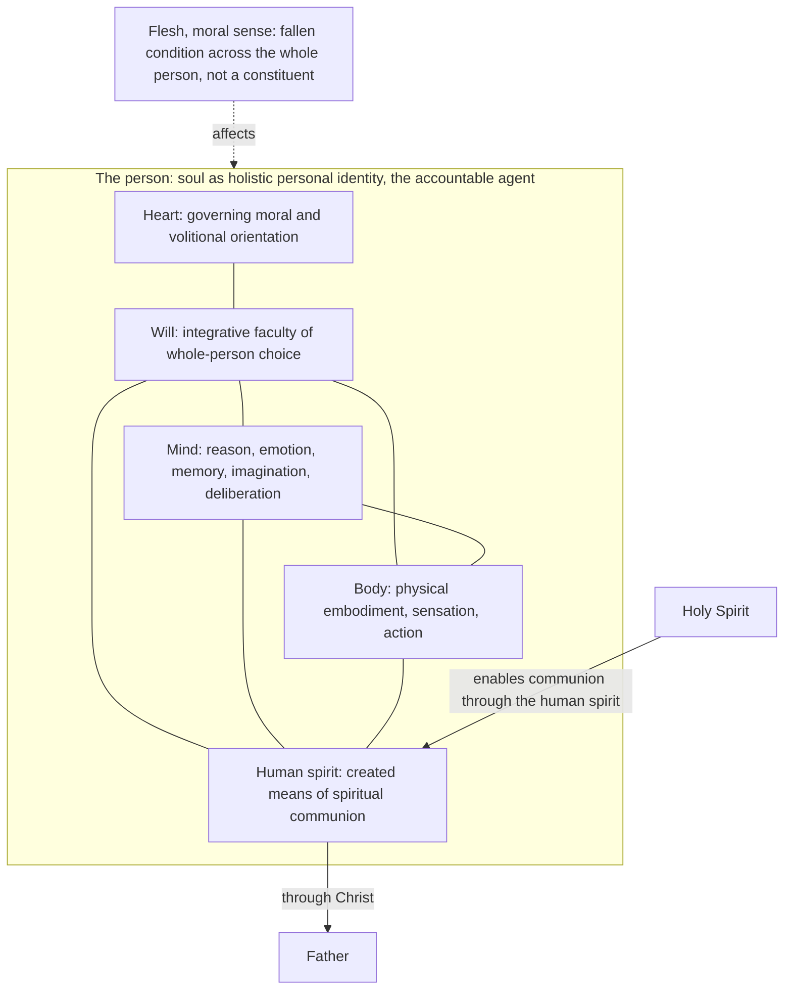

# Integrated Tripartite Anthropology (ITA): Provisional Baseline

**Status:** PROVISIONAL baseline
**Owner:** James (JD) Longmire
**Byline:** James (JD) Longmire / ORCID: 0009-0009-1383-7698 / Northrop Grumman Fellow (unaffiliated research)
**Repository:** jdlongmire/oddxian-apologetics
**Work package:** `work-packages/WP-INTEGRATED-TRIPARTITE-ANTHROPOLOGY.md`
**Provenance:** Captured 2026-11-27 from the AI Bridge filing `inbox/thinx-muse/2026-11-27-thinx-gpt-ita-baseline-and-fallback.md` in jdlongmire/ai-bridge (sender: thinx-gpt; date: 2026-11-27). JD Longmire directed the pickup in the main chat on 2026-11-27 and ruled the same day that the baseline homes in this repository, the oddXian theology lab, rather than in jdlongmire/biblical-worldmodel. The tripartite model at the center of this record was explicitly originated by JD; refinements he accepted are recorded as refinements in the text.

## Standing of this document

This document is a provisional working baseline. It records an agreed working record so that later validation work proceeds against a fixed, traceable text. It does **not** claim mature doctrine, and it does **not** claim completed exegetical validation. Scripture is cited by reference (book chapter:verse) throughout; Scripture governs the programme, and sources are to be ESV and verified primary sources, with no fabricated citations.

## Assurance gates at a glance

- **G0, conceptual agreement:** reached. The agreed working record in section 1 is the agreement.
- **G1, capture:** this document.
- **G2, independent verification:** pending. Independent verification of completeness, fidelity, traceability, configuration, and remote content, distinct from the capture self-check.
- **G3, working baseline acceptance:** the immediate stop-and-hold point. Acceptance is JD's decision and has not been given.
- **G4, theological validation:** not begun. Executed through validation work packages ITA-01 through ITA-07 (section 3). G4 does not block the next component.
- **G5, mature position acceptance:** not begun. Follows G4 findings; JD's final programme acceptance is subject to Scripture.

---

# 1. Agreed working record

## 1.1 Constitution: soul, mind, body, and spirit

Man is a unified personal being created in God's image (Gen 1:26-27). Mind, body and spirit are distinguishable integrated dimensions of constitution. Soul denotes holistic personal identity (Gen 2:7, living being; animals also described as living beings, so imago Dei distinguishes man). Mind is seat of reason, emotion, memory, imagination and deliberation; body is physical embodiment, sensation and action; human spirit is the created means of spiritual communion, particularly with God. JD explicitly originated the tripartite model, holistic soul, flesh as fallenness, mind and spirit cooperating with Holy Spirit to overcome flesh, human spirit as means of communion, and mind as seat of reason and emotion. JD accepted refinements: heart is governing moral/volitional orientation; will is integrative faculty of whole-person choice; soul is accountable agent. Mind and body influence each other; spiritual, cognitive, affective and physical domains overlap. Functional distinctions do not establish metaphysical irreducibility. Mechanism means created means, not disclosed metaphysical mechanics.

## 1.2 Heart, flesh, sin, and the Fall

Heart terminology overlaps cognition, emotion, desire, intentions and choice (Mark 2:6-8; Rom 10:9-10; Ps 37:4; Heb 4:12; 2 Cor 9:7; Prov 4:23; Matt 15:18-19). Jer 17:9-10 describes desperately sick heart (ESV; KJV wicked); Hebrew kidneys rendered mind in ESV, so do not infer rigid ontology. Flesh in moral sense is pervasive fallen corruption and disordered inclinations, affecting whole person; distinguish physical, kinship and mortality senses of sarx. Body is good created constitution. Sin is transgression; inherited corruption and imputed guilt are separate questions. Fall affects reason, emotion, body, spirit and heart (Gen 3:6; Rom 1:21; Eph 2:1-3; Gal 5). Spiritual death is alienation, not cessation of spirit. Christ's sinless humanity demonstrates embodiment and emotion are good (John 11:35; Mark 3:5; Luke 10:21).

## 1.3 Communion, regeneration, and sanctification

Communion with Father through Christ by Holy Spirit (Eph 2:18); human spirit is created capacity, God supplies initiative, means and efficacy. Rom 8:16; John 4:24; 1 Cor 6:17; 2:11-14 support spiritual communion; 1 Cor 14:14-15 distinguishes mind and spirit functionally. Regeneration sovereignly restores spiritual life and reorients heart (Ezek 36:26-27; John 3; Eph 2); Holy Spirit indwells and enables whole-person sanctification. Mind receives truth, reasons and feels; spirit communes; body senses and acts; heart governs orientation; person wills. Residual flesh resisted until glorification (Rom 8:13-16; 12:2; 6:12-13; Phil 2:12-13; 4:8-9; Col 3:1-17). Good works evidence salvation, never meritorious credit (Eph 2:8-10). Regeneration precedes faith in JD's Reformed framework. Use personal pronouns He/Him/His for Holy Spirit.

## 1.4 Christological constraint and eschatological frame

Christological constraint: one divine person, full divine and human natures, no separate human person; human body Heb 2:14, mind Luke 2:52, spirit Luke 23:46, soul Matt 26:38, will Luke 22:42, sinless Heb 4:15. Distinguish mortality from moral corruption. Death separates body and spirit (James 2:26; Eccl 12:7); intermediate state identity persists (Phil 1:23; Luke 23:43; Rev 6:9-11 apocalyptic caveat). Conscious disembodied cognition mechanism unresolved. Resurrection and glorification perfect whole person (1 Cor 15:42-49; Rom 8:23; Phil 3:21). Original very good distinct from perfected; Augustinian four states as comparative framework. Imago Dei rational/spiritual/moral/relational/purposeful capacities; avoid mapping constituents to Trinity persons.

---

# 2. Functional architecture

Soul encompasses mind, body, spirit in mutual interaction; heart governing orientation and will integrated personal agency operate across whole person. Flesh is a condition across whole person, not a fourth constituent. Holy Spirit enables communion through human spirit, through Christ to Father; no hierarchy within Trinity implied.

The diagram below is provisional, as is this whole baseline.

Reading the diagram against the record:

- Soul denotes the whole person in holistic personal identity; mind, body, and spirit are distinguishable, integrated dimensions of that one person's constitution, in mutual interaction.
- Heart (governing orientation) and will (integrated personal agency) operate across the whole person; they are not additional constituents alongside mind, body, and spirit.
- Flesh in the moral sense is a fallen condition across the whole person, not a fourth constituent.
- Communion runs: Holy Spirit enables communion through the human spirit, through Christ, to the Father. No hierarchy within the Trinity is implied.

---

# 3. Validation work packages

Theological validation (gate G4) is organized as seven work packages. They are recorded here as part of the baseline; none has been executed under this capture, and no exhaustive lexical or comparative literature review has been performed.

- **ITA-01, biblical lexicon:** Hebrew and Greek lexical work underlying the record's terms (soul, spirit, mind, heart, flesh, sarx, and their Hebrew counterparts).
- **ITA-02, ontology:** the ontological status of the distinctions the record draws functionally.
- **ITA-03, hamartiology:** sin, flesh, inherited corruption, and imputed guilt, keeping the questions the record separates distinct.
- **ITA-04, soteriology:** regeneration, faith, sanctification, good works, and glorification in the order the record states them.
- **ITA-05, Christology:** testing the record against the Christological constraint of section 1.4.
- **ITA-06, eschatology:** death, the intermediate state, resurrection, and glorification.
- **ITA-07, comparative theology:** dichotomy, traditional trichotomy, Christian physicalism, and holistic anthropology as comparative frameworks.

## 3.1 Claim classification scheme

Every claim assessed under ITA-01 through ITA-07 is classified as one of:

- **explicit teaching**;
- **necessary inference**;
- **plausible inference**;
- **unresolved hypothesis**.

## 3.2 Challenge passages

The validation work must address at least: 1 Thess 5:23; Heb 4:12; Matt 10:28; Mark 12:30; Rom 7 (disputed speaker); 1 Cor 15:44-46.

## 3.3 Test questions

- Must soul be a distinct constituent, or does the record's holistic use stand?
- Is mind irreducible, or a faculty of spirit?
- Are heart-as-governing-orientation and the will's allocation of agency adequate as stated?
- Are conscious disembodied existence and orthodox Christology accommodated by the model?

## 3.4 Confidence recorded in the source record

- **High confidence:** functional distinctions; soul can denote the whole; moral flesh; Spirit-enabled sanctification; glorification.
- **Uncertain:** ontological irreducibility.
- **Low confidence:** soul exclusively whole.
- **Medium confidence:** heart as governing orientation.

## 3.5 Source discipline

Scripture governs. Use ESV and verified primary sources; avoid fabricated citations. No exhaustive lexical or comparative literature review has been performed yet, and none is claimed by this baseline.

---

# 4. Assurance gates

- **G0, conceptual agreement reached.** The agreed working record of section 1.
- **G1, capture.** This document, under the ITA work package in this repository.
- **G2, independent verification** of completeness, fidelity, traceability, configuration, and remote content. Implementation and repository integrity sit with Thinx-Muse; independent record verification is arranged distinct from the capture self-check. An adversarial theological review (Claude lane) may be assigned through the AI Bridge if authorized.
- **G3, working baseline acceptance** is the immediate stop-and-hold point. Acceptance is JD's.
- **G4, theological validation.** Executed through ITA-01 through ITA-07. The next component is not blocked on G4.
- **G5, mature position acceptance after findings.** JD's final programme acceptance is subject to Scripture. The next component is not blocked on G5.

Reporting discipline under these gates: exact branch, pull request, SHA, checks, independent review status, and remaining uncertainties are reported at each step; delivery, receipt, and closure are kept distinct.

---

# 5. Cross-references

ITA interfaces with, and may be cross-referenced against, the following programmes where appropriate: TRT, DFM (Designed Functional Maturity), PFH (Pre-Fall Hypothesis), Systematics Illustrated, and God's Word, God's World. ITA stands independently of those programmes: its record, validation, and acceptance do not depend on them, and their state does not settle any ITA question.

Biblical WorldModel (jdlongmire/biblical-worldmodel) references ITA through an interface note in its anthropology world domain. ITA content does not live in BWM; this repository is its home.

Human-Curated, AI-Enabled (HCAE)
