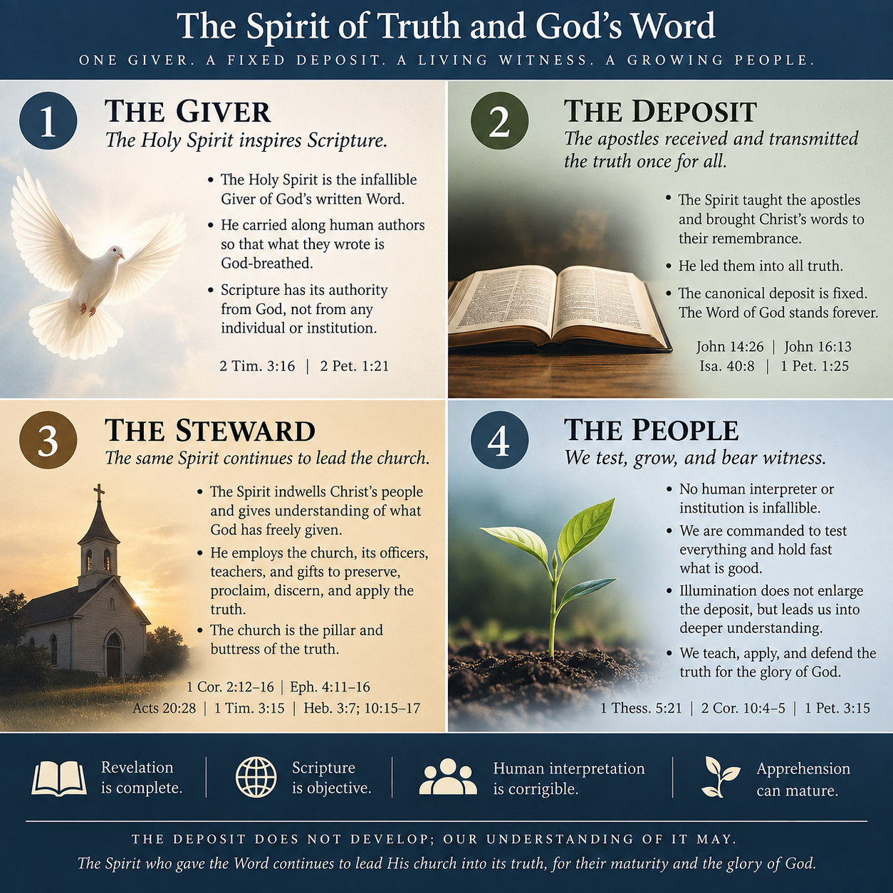

# The Spirit of Truth and God's Word

## Confessional statement

We believe that the Holy Spirit, the Spirit of truth, is the infallible Giver and Steward of God's written Word. He inspired the Scriptures, carrying along their human authors so that what they wrote is God-breathed and possesses its authority from God alone (2 Tim. 3:16; 2 Pet. 1:21).

We believe that the Spirit led the apostles into the truth entrusted through them, teaching them and bringing Christ's words to their remembrance (John 14:26; 16:13), and that this same Spirit continues to lead Christ's church in the faithful apprehension, discernment, teaching, and application of the truth once given (1 Cor. 2:12-16; Eph. 4:11-16; Heb. 3:7; 10:15-17).

We believe that the canonical deposit is fixed and that the Word of God stands forever (Isa. 40:8; 1 Pet. 1:25). Its authority neither originates in nor depends upon any individual, council, church, or institution, though the Spirit providentially employs the church, its officers, teachers, gifts, and individual members in preserving, proclaiming, defending, and applying the truth (1 Cor. 12:11; Eph. 4:11-16; Acts 20:28; 1 Tim. 3:15).

We believe that no human interpreter or institution is thereby rendered infallible. Therefore, all claims concerning truth are to be tested, and what is good held fast (1 Thess. 5:21). The Spirit's illumination neither enlarges nor alters revelation, but leads God's people into increasingly faithful understanding of what He has given.

Therefore, **revelation is complete, Scripture is objective, human interpretation is corrigible, and apprehension can mature**. The deposit does not develop; our understanding of it may. The Spirit who gave the Word continues faithfully to steward His Word among the people of God, for their maturity, the defense of the faith, and the glory of God (Eph. 4:11-16; 2 Cor. 10:4-5; 1 Pet. 3:15).

## Theological formulation

There is an infallible Giver and Steward of God's Word: the Holy Spirit, the Spirit of truth. Scripture has its source and authority in God. All Scripture is God-breathed (2 Tim. 3:16), and men spoke from God as they were carried along by the Holy Spirit (2 Pet. 1:21). Christ promised that the Spirit would teach His apostles and bring His words to their remembrance (John 14:26), and that the Spirit of truth would guide them into all truth (John 16:13). This promise has an immediate and foundational application to the apostles through whom the New Covenant deposit was authoritatively given, but the Spirit's ministry of truth is not exhausted by the apostolic generation. The same Spirit indwells Christ's people, gives understanding of what God has freely given (1 Cor. 2:12-16), equips the church for growth into the knowledge of Christ and doctrinal maturity (Eph. 4:11-16), and continues to speak through the written Word (Heb. 3:7; 10:15-17). Thus the Spirit who led the apostles into the truth He entrusted through them continues to lead the church in the apprehension, discernment, and faithful application of that same truth.

The canonical deposit therefore possesses its authority from God. It does not acquire that authority through the recognition of any individual or institution. The Spirit is both its Giver and its continuing Steward.

The Word itself is enduring. "The word of our God will stand forever" (Isa. 40:8), and Peter applies that declaration directly to the gospel proclaimed to the church (1 Pet. 1:25). Scripture likewise treats the written Word as the Spirit's continuing speech: "as the Holy Spirit says" introduces the already-written words of Psalm 95 (Heb. 3:7), and "the Holy Spirit also bears witness to us" introduces the already-given words of Jeremiah (Heb. 10:15-17). The written deposit therefore remains living divine address without requiring continuing canonical revelation.

The deposit is fixed and independent of the authority of any individual or institution. Yet the Spirit providentially employs both individuals and the church in its preservation, teaching, discernment, and application. He distributes gifts as He wills (1 Cor. 12:11), gives apostles, prophets, evangelists, shepherds, and teachers for the equipping and maturation of the saints (Eph. 4:11-16), appoints overseers to shepherd the church (Acts 20:28), and establishes the church as the pillar and buttress of the truth (1 Tim. 3:15).

This stewardship does not render human interpreters or institutions infallible. We are commanded to test everything and hold fast what is good (1 Thess. 5:21). The authority against which claims are ultimately tested is the truth God has given, rather than the interpreter who claims to possess it. Neither does this mandate reduce interpretation to isolated private judgment. The Spirit equips the whole body with gifts, teachers, overseers, and mutual ministry so that the church may grow together toward maturity in the truth (Eph. 4:11-16).

A necessary distinction follows: revelation is complete, while human apprehension remains corrigible and capable of growth. Illumination does not enlarge the canonical deposit. Discovery does not create new revelation. The Spirit leads the church into truth by bringing God's people into increasingly faithful apprehension of what God has already revealed and of the created reality to which His truth applies.

We are therefore mandated to test everything and hold fast what is good (1 Thess. 5:21), discerning and applying the truth God has given so that God is glorified; the saints are equipped and built up into maturity (Eph. 4:11-16); arguments and every lofty opinion raised against the knowledge of God are torn down (2 Cor. 10:4-5); and we are prepared to give a reasoned defense of the hope that is in us, with gentleness and respect (1 Pet. 3:15).

**Revelation is complete. Scripture is objective. Human interpretation is corrigible. Apprehension can mature.**

The Giver of Scripture remains its infallible Steward. The deposit is fixed. The Spirit who gave it continues to lead Christ's church into its truth. Its human recipients remain fallible, so our apprehension may deepen, our errors may be corrected, and our understanding may mature without revelation itself developing.
